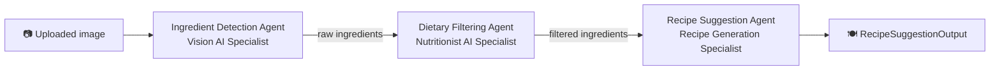
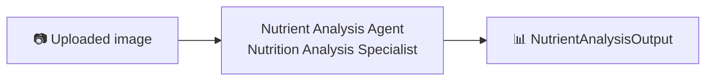

# 🥗 NourishBot — AI Multi-Agent Nutrition Assistant

NourishBot is a multi-agent AI application built with **[CrewAI](https://www.crewai.com/)**, **Google Gemini** and **[Gradio](https://www.gradio.app/)**.
Upload a photo of food and NourishBot will either:

- 🍽 **Suggest recipes** based on the ingredients it detects (e.g. a photo of your fridge), respecting your dietary restrictions (vegan, keto, gluten-free, ...), or
- 📊 **Analyze a finished dish**, giving a calorie estimate, macro/micronutrient breakdown and a short health evaluation.

---

## ✨ Features

- **Vision-based ingredient detection** using Gemini multimodal models.
- **Dietary filtering** — removes ingredients that don't match restrictions such as `vegan`, `keto`, `gluten-free`.
- **Recipe generation** with ingredients, step-by-step instructions and calorie estimates.
- **Nutritional analysis** — dish identification, portion size, calories, protein / carbs / fats, vitamins (%DV), minerals and a health evaluation.
- **Structured outputs** enforced via Pydantic models, rendered as clean Markdown tables.
- **Automatic retry with exponential backoff** on Gemini `503` / `429` errors.
- **Gradio web UI** with built-in examples for one-click testing.
- **Docker support** for easy deployment.

---

## 🧠 Architecture

NourishBot provides two CrewAI workflows, both running in `Process.sequential` mode.

### 1. Recipe workflow (`NourishBotRecipeCrew`)



### 2. Analysis workflow (`NourishBotAnalysisCrew`)



### Agents & tools

| Agent | Role | Tools |
|-------|------|-------|
| `ingredient_detection_agent` | Vision AI Specialist | `Extract ingredients`, `Filter ingredients` |
| `dietary_filtering_agent` | Nutritionist AI Specialist | `Filter based on dietary restrictions` |
| `nutrient_analysis_agent` | Nutrition Analysis Specialist | `Analyze nutritional values and calories of the dish from uploaded image` |
| `recipe_suggestion_agent` | Recipe Generation Specialist | — (LLM only) |

Agent roles/goals/backstories and task descriptions are defined in YAML under [`src/config/`](src/config).

---

## 📁 Project Structure

```
NourishBot/
├── app.py                 # Gradio UI + output formatting (entry point)
├── src/
│   ├── crew.py            # CrewAI agents, tasks and the two crews
│   ├── tools.py           # Custom tools powered by Google Gemini (google-genai)
│   ├── models.py          # Pydantic output schemas
│   └── config/
│       ├── agents.yaml    # Agent definitions
│       └── tasks.yaml     # Task definitions
├── examples/              # Sample images used in the Gradio examples
├── assignments/           # Extra CrewAI practice exercise (BookBuddy)
├── requirements.txt
├── Dockerfile
└── .env                   # Your Gemini API key (not committed)
```

---

## 🚀 Getting Started

### Prerequisites

- Python **3.10+** (Docker image uses 3.11)
- A **Google Gemini API key** — get one from [Google AI Studio](https://aistudio.google.com/app/apikey)

### 1. Clone the repository

```bash
git clone https://github.com/<your-username>/NourishBot.git
cd NourishBot
```

### 2. Create a virtual environment and install dependencies

```bash
python -m venv venv
# Windows
venv\Scripts\activate
# macOS / Linux
source venv/bin/activate

pip install -r requirements.txt
```

### 3. Configure environment variables

Create a `.env` file in the project root:

```env
GEMINI_API_KEY=your_gemini_api_key_here
```

### 4. Run the app

```bash
python app.py
```

Open your browser at **http://localhost:5000**.

---

## 🐳 Run with Docker

```bash
docker build -t nourishbot .
docker run -p 5000:5000 --env-file .env nourishbot
```

Then visit **http://localhost:5000**.

---

## 🖥 Usage

1. **Upload an image**
   - For **recipe** mode: a photo of raw ingredients / the contents of your fridge.
   - For **analysis** mode: a photo of a complete dish.
2. **Dietary Restrictions (optional)** — e.g. `vegan`, `keto`, `gluten-free`. Leave blank for analysis mode.
3. **Select the workflow type**: `recipe` or `analysis`.
4. Click **Analyze** and wait for the agents to finish.

You can also click one of the provided **examples** to autofill the inputs and run immediately.

### Example output (analysis)

| **Nutrient** | **Amount** |
|--------------|------------|
| **Protein** | 35g |
| **Carbohydrates** | 42g |
| **Fats** | 18g |

> The values above are illustrative only.

---

## ⚙️ Configuration

| Setting | Location | Default |
|---------|----------|---------|
| Agent LLM | `src/crew.py` → `LLM(model=...)` | `gemini/gemini-3.1-flash-lite` |
| Vision model for tools | `src/tools.py` → `VISION_MODEL` | `gemini-3.1-flash-lite` |
| Temperature | `src/crew.py`, `src/tools.py` | `0` |
| Server host / port | `app.py` → `demo.launch(...)` | `0.0.0.0:5000` |

> [!TIP]
> If you frequently hit `503` (model overloaded) errors, switch the model to `gemini-2.5-flash`.

---

## 🛠 Tech Stack

- [CrewAI](https://github.com/crewAIInc/crewAI) — multi-agent orchestration
- [Google Gen AI SDK](https://github.com/googleapis/python-genai) — Gemini vision & text models
- [Gradio](https://www.gradio.app/) — web interface
- [Pydantic](https://docs.pydantic.dev/) — structured output validation
- [Pillow](https://python-pillow.org/), `requests`, `python-dotenv`, `PyYAML`

---

## ⚠️ Disclaimer

The nutritional information and calorie estimates provided by NourishBot are **approximate** and based on general food data generated by an AI model. Actual values may vary depending on portion size, specific ingredients, preparation methods and individual variations. For precise dietary advice or medical guidance, consult a qualified nutritionist or healthcare provider.

---

## 📄 License

This project is released under the MIT License. Feel free to use and modify it.
